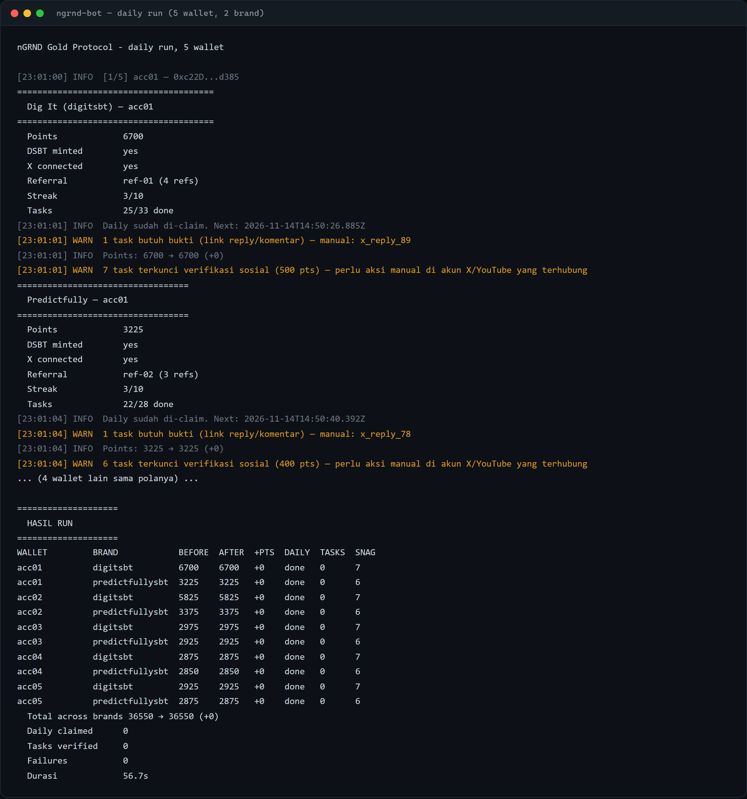

# nGRND Gold Protocol Bot

**Versi:** 1.0.0 · **Harga:** Rp 95.000 (~$6) · **Kontak pembelian:** [@rmndkyl](https://t.me/rmndkyl)

Bot auto-farm untuk **nGRND Gold Protocol DSBT** (Dynamic Soulbound Token) — dua kampanye sekaligus: **Dig It** (`digitsbt`) dan **Predictfully** (`predictfullysbt`).

## Kebutuhan

| Item | Detail |
|---|---|
| Runtime | Node.js 18+ |
| Wallet | EVM / sesuai chain proyek (kamu sendiri) |
| Proxy | tidak perlu |
| Captcha | tidak perlu |
| Akses | akun proyek yang kamu kelola sendiri |

## Pembayaran

E-Wallet: DANA / GoPay / ShopeePay · Bank: BCA / Seabank · Crypto: contact for wallet address.
Pembeli menghubungi [@rmndkyl](https://t.me/rmndkyl), kirim bukti transfer, lalu terima license key.

---

Bot auto-farm untuk **nGRND Gold Protocol DSBT** (Dynamic Soulbound Token) — dua kampanye sekaligus:
**Dig It** (`digitsbt`) dan **Predictfully** (`predictfullysbt`).

Setiap run: klaim daily streak + selesaikan semua quest yang bisa diverifikasi server secara instan,
di semua wallet, di dua campaign, tanpa captcha, tanpa gas, tanpa signature.

> Dibuat oleh **LYID — Layer Airdrop ID** · [@layerairdrop](https://t.me/layerairdrop) · [@rmndkyl](https://github.com/rmndkyl)

---

## Fitur

- **Multi-wallet, multi-campaign** — satu run menyapu semua wallet di kedua brand (`digitsbt` + `predictfullysbt`)
- **Daily streak claim** otomatis — deteksi `canClaim`, klaim, dan laporkan bonus streak day-10
- **Auto-verify quest instan** — `web_visit`, `x_like`, `youtube_like`, `discord_join` selesai dalam 1 request
- **Report task terkunci** — semua task yang butuh verifikasi sosial (retweet/reply/subscribe) dikelompokkan
  lengkap dengan URL, jadi kamu tahu persis apa yang harus dikerjakan manual
- **Retry otomatis** — backoff eksponensial untuk 429/5xx dan gangguan jaringan (3x default)
- **Human-like pacing** — jeda acak antar request (1.5–4.2 detik) dan antar wallet (6 detik)
- **3 mode aman** — `report` (read-only), `dry-run` (rencana saja), `daily` (eksekusi)
- **State tracking** — `data/state.json` menyimpan poin terakhir + jumlah task terkunci per wallet
- **Tanpa dependency** — hanya Node.js built-in (`fetch`), tidak perlu `npm install`

---

## Kebutuhan

| Item | Wajib? | Biaya | Catatan |
|---|---|---|---|
| Node.js >= 18 | Ya | Gratis | `node --version` |
| Wallet EVM (address saja) | Ya | Gratis | Private key **TIDAK** diperlukan |
| DSBT sudah di-mint | Ya | Gratis | Mint manual di `/sbt` (butuh email + Telegram + X) |
| X (Twitter) terhubung ke wallet | Untuk task `x_*` | Gratis | OAuth di halaman `/sbt/tasks` |
| Proxy | Tidak | Opsional | Tidak dipakai secara default |
| Captcha solver | **Tidak** | — | Platform ini tidak pakai captcha |
| Modal / deposit | **Tidak** | **Rp 0** | Tidak ada transaksi on-chain sama sekali |

### Biaya & tipe campaign

| Aspek | Status |
|---|---|
| Tipe campaign | **C — Quest Platform / D — Social Tasks** (off-chain, poin) |
| Modal | **Rp 0** — tidak ada gas, deposit, atau signature |
| Reward | Pool ~$348,728 USDT, dibagi proporsional ke poin |
| Estimasi nilai | ~$0.0026 / poin → wallet 6.000 poin ≈ $16 |
| Risiko modal | Nol (tidak ada aset yang dipertaruhkan) |

---

## Setup

### 1. Install

Tidak ada dependency eksternal. Cukup salin folder dan pastikan Node.js tersedia:

```bash
cd ngrnd-bot
node --version   # harus >= 18
```

### 2. Isi `wallets.json`

```json
[
  { "label": "wallet-utama", "address": "0xabc...123" },
  { "label": "wallet-2",     "address": "0xdef...456" }
]
```

- `label` = nama bebas untuk laporan
- `address` = address EVM (0x + 40 hex)
- **Private key tidak dibutuhkan** untuk farming harian — bot hanya butuh address publik

### 3. Sesuaikan `config.json` (opsional)

```json
{
  "brands": [ { "id": "digitsbt", "baseUrl": "https://digitsbt.ngrndrewards.com" }, ... ],
  "autoClaimDaily": true,
  "autoVerifyFreeTasks": true,
  "reportSnagTasks": true,
  "delayMinMs": 1500,
  "delayMaxMs": 4200,
  "pauseBetweenWalletsMs": 6000,
  "maxRetries": 3
}
```

| Key | Fungsi |
|---|---|
| `autoClaimDaily` | Klaim reward harian + streak |
| `autoVerifyFreeTasks` | Selesaikan quest yang bisa diverifikasi instan |
| `reportSnagTasks` | Tampilkan daftar task yang butuh aksi manual |
| `delayMinMs` / `delayMaxMs` | Jeda acak antar request (anti-pola-bot) |
| `pauseBetweenWalletsMs` | Jeda antar wallet |
| `maxRetries` | Retry untuk 429/5xx |

---

## Cara pakai

```bash
node index.js            # menu interaktif
node index.js --daily    # langsung jalan (untuk cron)
node index.js --report   # read-only: cek poin & task tanpa aksi
node index.js --dry-run  # tampilkan rencana tanpa kirim request tulis
```

Menu interaktif:

```
1) Jalankan semua wallet (claim + verify)
2) Report saja (read-only, tanpa aksi)
3) Dry-run (tampilkan rencana tanpa kirim)
4) Pilih satu wallet
0) Keluar
```

### Contoh output

```
====================
  HASIL RUN
====================
WALLET         BRAND            BEFORE  AFTER  +PTS  DAILY  TASKS  SNAG
acc01          digitsbt         6150    6175   +25   done   1      10
acc01          predictfullysbt  2450    2550   +100  +25    3      9
acc02          digitsbt         5250    5300   +50   +25    1      10
...
  Total points       29800 → 30425 (+625)
  Daily claimed      7
  Tasks verified     18
  Failures           0
```

### Menyelesaikan task sosial X (retweet / reply)

Task `x_retweet`, `x_reply`, `x_follow` diverifikasi server terhadap akun X yang terhubung,
jadi butuh sesi X. Alurnya:

```
1. Copy cookie dari Chrome (lihat x_sessions_input.txt untuk panduan klik)
2. node tools/parse_x_cookies.mjs         -> x_sessions.json
3. node tools/x_engage.mjs --dry          -> lihat rencana
4. node tools/x_engage.mjs --all          -> kerjakan (retweet + reply + verify)
```

| Variabel | Default | Fungsi |
|---|---|---|
| `X_MAX_ACTIONS` | 4 | batas aksi tulis per akun per run |
| `X_DELAY_MIN_MS` | 45000 | jeda minimum antar aksi |
| `X_DELAY_MAX_MS` | 90000 | jeda maksimum antar aksi |

> **Penting:** X membatasi jumlah posting per akun (error `344`). Kalau akun sudah dipakai bot
> engagement lain, kuota postingnya cepat habis dan `x_engage` akan berhenti dengan pesan
> `STOP: rate limit akun (344)`. Itu bukan bug — jalankan lagi nanti (1–2 aksi per akun per
> 3 jam), atau kurangi aktivitas bot lain di akun tersebut.

`x_engage` membaca query ID GraphQL (`CreateRetweet`, `CreateTweet`) langsung dari bundle web
X setiap kali jalan, jadi tidak cepat rusak saat X mengganti hash.

### Jadwal harian (Windows Task Scheduler)

```
Program:   node
Arguments: index.js --daily
Trigger:   Daily, 08:00
```

Atau cron (WSL/Linux): `0 8 * * * cd ~/LYID-BOTS/ngrnd-bot && node index.js --daily >> run.log 2>&1`

---

## Yang otomatis vs yang manual

| Task | Otomatis? | Kenapa |
|---|---|---|
| `daily_checkin` (daily claim) | Ya | Endpoint `/api/tasks/daily-claim` |
| `web_visit` | Ya | Server tidak mengecek kunjungan |
| `x_like` | Ya | Server tidak mengecek like |
| `youtube_like` | Ya | Server tidak mengecek like |
| `discord_join` | Ya | Server tidak mengecek join |
| `x_retweet` | **Ya, kalau kuota X tersedia** | `tools/x_engage.mjs` — berhenti sendiri saat kena limit 344 |
| `x_reply` | **Ya, kalau kuota X tersedia** | idem, teks reply bervariasi otomatis |
| `x_follow` | Manual | Server cek follow (sudah selesai di semua wallet) |
| `youtube_subscribe` | **Manual** | Server cek langganan (async, status `pending`) |
| `youtube_comment` | **Manual** | Butuh link komentar YouTube (`contentUrl`) |

Bot akan selalu menampilkan daftar task manual di akhir run, lengkap dengan URL-nya.

---

## Bukti run (dari bot sendiri, bukan mockup)



Kartu di atas dibaca langsung dari `data/last-run.txt` hasil run sungguhan: 5 wallet × 2 brand
(Dig It + Predictfully), 36.550 poin total. Label wallet di-mask (`acc01`–`acc05`), alamat
dipotong, kode referral disamarkan. Pada run itu klaim harian sudah dilakukan cron sebelumnya
di hari yang sama ("Daily sudah di-claim" + `Next`), jadi +PTS nol — bukan gagal, memang sudah
diklaim lebih awal.

## Info project

| Item | Detail |
|---|---|
| Nama | nGRND Gold Protocol (DSBT / Dynamic Soulbound Token) |
| Parent | nGRND Inc — tokenised in-ground gold & RWA (`ngrnd.com`) |
| Campaign | Dig It (`digitsbt`) · Predictfully (`predictfullysbt`) |
| Chain / aset | Off-chain (poin). Reward dibayar USDT/USDC |
| Reward pool | ~$348,728 (naik $0.70/menit) |
| Peserta | 855K+ (per rilis pers Juni 2026), 133M poin terkumpul |
| Status airdrop | Token Gold Protocol direncanakan rilis akhir 2026 |
| Verifikasi | Email + Telegram + X (triple verified) |
| Referral | +75 poin referrer, +25 poin referee |
| Website | https://digitsbt.ngrndrewards.com/sbt/tasks |

---

## Struktur file

```
ngrnd-bot/
├── index.js            # CLI menu + entry point (--daily / --report / --dry-run)
├── config.json         # Konfigurasi brand, delay, retry
├── wallets.json        # Daftar address wallet (.gitignored)
├── src/
│   ├── api.js          # HTTP client + retry/backoff
│   ├── runner.js       # Logika claim, verify, klasifikasi task
│   └── logger.js       # Logger berwarna
├── data/
│   └── state.json      # Riwayat run + poin terakhir per wallet
├── README.md
└── .gitignore
```

---

## Troubleshooting

| Masalah | Penyebab | Solusi |
|---|---|---|
| `wallets.json tidak ditemukan` | File belum dibuat | Buat array `[{label,address}]` |
| `tidak berisi address EVM yang valid` | Format address salah | Harus `0x` + 40 karakter hex |
| Semua task `SNAG` tinggi, poin tidak naik | DSBT belum di-mint | Mint manual di `/sbt` |
| `wallet belum punya DSBT` | Sama seperti di atas | Selesaikan email + Telegram + X lalu mint |
| Daily claim selalu "sudah di-claim" | Cooldown 24 jam | Normal — jalankan sekali sehari |
| `x_retweet` gagal terus | Belum repost di akun X yang terhubung | Repost manual, lalu klik Verify di web |
| `youtube_subscribe` status `pending` | Server cek async (bisa beberapa menit) | Jalankan bot lagi 5–10 menit kemudian |
| Poin naik tapi tidak muncul di web | Cache browser | Refresh halaman |

---

## Disclaimer

Bot ini hanya memanggil endpoint publik yang sama dengan yang dipanggil frontend resmi.
Tidak ada transaksi on-chain, tidak ada private key yang disimpan, dan tidak ada modal yang
dipertaruhkan. Gunakan dengan wallet farming, bukan wallet utama berisi aset.

## Kontak

- Telegram channel: [@layerairdrop](https://t.me/layerairdrop)
- Telegram: [@rmndkyl](https://t.me/rmndkyl)
- GitHub: [github.com/rmndkyl](https://github.com/rmndkyl)